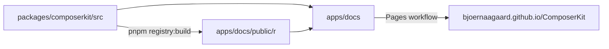

# ComposerKit

ComposerKit is a set of React components for chat and agent apps, such as a message composer, a conversation view, tool calls and code diffs. The components use Tailwind CSS and Base UI, and you connect them to your own model and backend.

The documentation, live demos and theme editor are at https://bjoernaagaard.github.io/ComposerKit/.

## Install

ComposerKit installs through the shadcn registry, which copies the component source into your app, so you can read and change every file. You need a Next.js app with a `src` folder.

First, set up shadcn and register the ComposerKit namespace. Second, add the components you want, for example the composer.

```bash
npx shadcn@latest init --defaults --yes
npx shadcn registry add '@composerkit=https://bjoernaagaard.github.io/ComposerKit/r/{name}.json'
npx shadcn add @composerkit/composer --overwrite --yes
```

The composer brings the ComposerKit styles into `src/styles/globals.css`. Import them from `src/app/globals.css`, in place of the styles that shadcn wrote there.

```css
@import "../styles/globals.css";
```

## Use a component

The page below shows a message box and prints each message you send under it. The [quickstart](https://bjoernaagaard.github.io/ComposerKit/docs) walks through the same page in a new Next.js app.

```tsx
"use client";

import { useState } from "react";

import { InlineComposer } from "@/components/ui/composer";
import { TooltipProvider } from "@/components/ui/tooltip";

export default function Home() {
  const [draft, setDraft] = useState("");
  const [sentText, setSentText] = useState("");

  return (
    <TooltipProvider>
      <InlineComposer
        canCancel={false}
        canSubmit={draft.trim() !== ""}
        label="Write a message"
        multiline
        onCancel={() => {}}
        onSubmit={() => {
          setSentText(draft);
          setDraft("");
        }}
        submitLabel="Send"
      >
        <textarea
          aria-label="Write a message"
          onChange={(event) => setDraft(event.target.value)}
          rows={1}
          value={draft}
        />
      </InlineComposer>
      <p aria-live="polite">{sentText}</p>
    </TooltipProvider>
  );
}
```

## Work on ComposerKit

The repository is a pnpm workspace with the component source and the documentation site.

```text
packages/composerkit/        # the component source that the registry copies
├── src/components/          # the components
├── src/lib/                 # helpers the components share
├── src/styles/              # global styles and design tokens
└── DESIGN.md                # the design tokens that src/styles is built from
apps/docs/                   # the documentation site and the component gallery
├── content/docs/            # the documentation pages in MDX
├── app/(gallery)/gallery/   # one demo page per component
├── examples/                # the demos that the gallery pages render
├── registry.json            # the shadcn registry, written from the source
└── public/r/                # the built registry files
```

The docs site imports the component source directly, so a change shows up in the gallery right away. The registry build turns the same source into the files that `npx shadcn add` downloads.



### Run the docs site

You need Node.js 26 and pnpm 12.

```bash
pnpm install
pnpm dev
```

The docs open at http://localhost:3003/ComposerKit/docs and the gallery at http://localhost:3003/ComposerKit/gallery. The site uses the `/ComposerKit` path in development too, because GitHub Pages serves it under that path.

### Add a shadcn component

Run the shadcn CLI inside the component package, so the files land in `packages/composerkit/src/components/ui`.

```bash
cd packages/composerkit
pnpm dlx shadcn@latest add button
```

Inside the repository, you import the components by the workspace package name. The registry build rewrites these imports to `@/` paths.

```tsx
import { Button } from "composerkit/components/ui/button";
```

### Rebuild the registry

The registry build reads the imports in `packages/composerkit/src`, so each component and the files it needs become one registry item. Run it after you change the source, and commit `apps/docs/registry.json` and `apps/docs/public/r` with your change.

```bash
pnpm registry:build
```

The Pages workflow runs the same build on every merge to `main` and fails when the committed registry differs from the build. It then publishes the docs site, the gallery and the registry to GitHub Pages. The Quickstart workflow follows the quickstart page in a new Next.js app against the registry in your branch.

### Check a change

```bash
pnpm typecheck
pnpm lint
pnpm build
```

`pnpm fix` formats the code and fixes the lint problems it can. The pre-commit hook runs it on the files you stage.

## License

MIT
